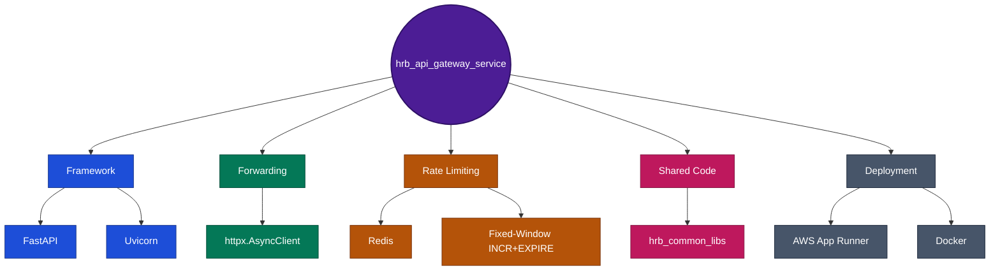

# hrb_api_gateway_service

The single public entry point for the HRB chatbot system - CORS, rate-limiting, and contract validation, centralized once for every backend service it fronts. **Role-based access is not enforced here** - see the correction in Section 5 below.

## For reviewers / new team members (5 minutes)

Written for someone picking this up cold - a new engineer, a reviewer, or (the actual reason this doc exists) a Forward Deployed Engineer walking into an unfamiliar codebase and needing to get productive fast, not just read about it.

1. Run it locally (below) and hit `GET /ping` - confirms the process is actually up before you read another line.
2. [Current state architecture](../docs/architecture/diagrams/api-gateway-current-state-architecture.drawio) - the request flow, including the RBAC gap, in one picture.
3. [Deployment architecture](../docs/architecture/diagrams/api-gateway-deployment-architecture.drawio) - the AWS resources this runs on.
4. [Target state (scaling)](../docs/architecture/diagrams/api-gateway-target-state-scaling-architecture.drawio) - what changes as usage grows from 100 to 5,000 employees, and why.
5. Section 5 below - the one correction worth knowing before you trust anything else this repo's docs say about security.

## Live demo

This Gateway fronts **[hrb-chatbot-ui.rvsree.dev](https://hrb-chatbot-ui.rvsree.dev)**
- every chat/leave-balance/HITL request from that UI passes through here
first. Pauses by default for cost control; a slow first response means it's
resuming, not broken.

## Quick start

```bash
pip install -r requirements.txt
uvicorn gateway.main:app --host 0.0.0.0 --port 8100 --app-dir src --reload
curl http://127.0.0.1:8100/ping
```

Tests: `pytest tests/ -v` (from the repo root; `pytest.ini` sets `pythonpath = src`, no path juggling needed).

## Tech stack



| Layer | What's actually used |
|---|---|
| Framework | FastAPI + Uvicorn |
| HTTP forwarding | `httpx.AsyncClient` (90s timeout) |
| Rate limiting | Redis, fixed-window `INCR`+`EXPIRE`, fails open if Redis is unreachable |
| Shared code | `hrb_common_libs[observability,db,cache,auth]`, pinned to `v0.4.0` via git tag |
| Deployment | AWS App Runner (Docker, 2-stage build), 256 CPU / 512 Memory |

## Status, 2026-10-23: live in production

Deployed to AWS App Runner (`https://necxf9n7mv.us-east-1.awsapprunner.com`), and `hrb_chatbot_ui` is cut over to call it instead of the backend directly - verified with a live CORS preflight and a forwarded `genai-rag-retrieval` query that returned a correct answer. CORS, rate-limiting (Redis-backed, shared across replicas), and contract validation are all built and working in production. See `ROADMAP.md` for phase history - one bug surfaced and got fixed along the way: the forwarder's client timeout (30s) was too short for a genuine `~60s` agentic query and tripped its own circuit breaker on calls that were slow, not failed - now `90s`.

## 5. Correction, 2026-10-24: RBAC is not actually enforced here

This README previously claimed `api/gateway/rbac.py`'s own RBAC role was "absorbed into this service" and built. **Verified directly against `main.py`, that's wrong.** The catch-all forwarding route's only dependency is the rate limiter - `rbac.py` is a real file in this repo, but it's never wired into `main.py`. The route's own comment says it plainly: *"a generic catch-all proxy has no per-path role mapping to enforce yet."* Role enforcement happens downstream, inside each backend service's own route body - not centrally, here. This is now documented accurately in the [current-state architecture diagram](../docs/architecture/diagrams/api-gateway-current-state-architecture.drawio) and in [`hrb_chatbot_service`'s own architecture.html for this service](../docs/platform-and-admin/api-gateway-service/architecture.html).

## Documentation index

| Doc | What it covers |
|---|---|
| [Overview / Spec / Architecture / Design / Decisions](../docs/platform-and-admin/api-gateway-service/) | The full HTML doc set for this service |
| [Build process](../docs/deployment-and-ops/build-and-deploy/02a-hrb-api-gateway-service-build-process.html) | Docker build, step-by-step, with a Java/Spring Boot comparison for anyone coming from a JVM background |
| [Deployment architecture (HTML)](../docs/deployment-and-ops/build-and-deploy/02b-hrb-api-gateway-service-deployment-architecture.html) | Same content as the `.drawio` above, narrative form |
| [`service-boundary-decision.html`](../docs/architecture/service-boundary-decision.html) | Why this service exists as its own repo, not folded into the backend |
| [`platform-overview.html`](../docs/architecture/platform-overview.html) | The cross-service hub - business capabilities, all 7 repos, one diagram |

Older paths under `docs/dev-reference/api-gateway-service/` (no `hrb_chatbot_v3/` prefix) referenced in earlier commits are stale - that folder was reorganized 2026-10-23, and the links above reflect the current location.
